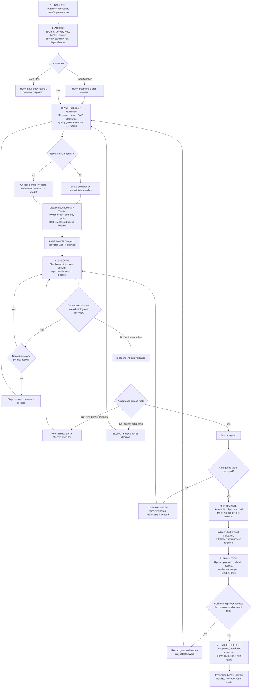

# Fleet project workflow benchmark

Date: 2026-08-30  
Scope: synthesis of public enterprise-delivery guidance and first-party multi-agent documentation against the Fleet workflow diagram.

## Conclusion

The existing diagram is a good task-delivery loop, but it is not yet a complete project operating model. The research supports adding two layers around it:

1. An **enterprise control spine**: assess, authorize, govern, transition, close, and review benefits.
2. An **agent execution system**: choose the orchestration mode, dispatch bounded contracts, checkpoint state, control authority, trace provenance, and validate the integrated result.

The best umbrella term is **orchestrated multi-agent workflow**, not “swarm.” AutoGen uses “Swarm” for a narrower decentralized handoff pattern; the proposed Fleet model keeps a coordinator and accountable owner in control. [AutoGen Swarm](https://microsoft.github.io/autogen/dev/user-guide/agentchat-user-guide/swarm.html) · [OpenAI Agents SDK orchestration](https://openai.github.io/openai-agents-python/multi_agent/)

## Research-backed lifecycle

```text
PROJECT:  Proposed -> Assessing -> Authorized -> Active -> Validating -> Transitioning -> Closed
FLAGS:                                Blocked / On Hold / At Risk
EXIT:                                 Canceled
LATER:                                                                 -> Benefits Review

TASK:     Assigned -> Acknowledged/Claimed -> Active -> In Review -> Accepted
EXCEPTIONS:                                  Blocked / Returned / Failed / Canceled
```

This separates project lifecycle from task workflow. `Claimed` is a task state; `Blocked` is an exception condition; and `Closed` is not the same as long-term benefit realization.

## Revised control map



## What enterprise practice contributes

- **Authorization before execution.** Public Goldman Sachs project-management expectations cover initiation, scoping, requirements, milestones, testing, implementation, quality assurance, risk escalation, and governance reporting. This is evidence of expected controls, not a disclosed firmwide Goldman methodology. [Goldman Sachs project-management role](https://higher.gs.com/roles/181993)
- **Distinct decision rights.** PwC emphasizes empowered sponsors, explicit decision rights, a single source of truth, portfolio coordination, PMO discipline, and live visibility into risk, cost, resources, and value. [PwC program governance and delivery risk](https://www.pwc.com/us/en/services/audit-assurance/library/program-governance-delivery-risk.html)
- **Controls throughout the lifecycle.** PwC identifies quality gates at design completion, test readiness, deployment planning, and go-live. Deloitte describes PMO controls spanning outcome management, risk and issues, planning/reporting, stakeholder management, health checks, and stage-gate reviews. [PwC](https://www.pwc.com/us/en/services/audit-assurance/library/program-governance-delivery-risk.html) · [Deloitte program leadership](https://www.deloitte.com/au/en/services/consulting/services/program-leadership.html)
- **Independent challenge and later benefits review.** UK government assurance guidance separates lifecycle assurance, formal approval, operational handover, and benefits realization. [NISTA assurance review toolkit](https://www.gov.uk/government/collections/nista-assurance-review-toolkit)

## What agent-system practice contributes

- **Choose the simplest adequate pattern.** Anthropic distinguishes fixed workflows from dynamic agents and recommends adding agentic complexity only when it improves the result. [Anthropic, Building effective agents](https://www.anthropic.com/engineering/building-effective-agents)
- **Separate parallel work from dynamic orchestration.** LangGraph's orchestrator decomposes work, sends isolated state to workers, collects results in shared state, and synthesizes them. [LangGraph workflows and agents](https://docs.langchain.com/oss/python/langgraph/workflows-agents)
- **Bound execution.** Agent runs need both a success condition and safety termination conditions such as turn, time, token, or retry limits; hitting a safety limit means blocked or failed, never accepted. [AutoGen termination](https://microsoft.github.io/autogen/0.4.8/user-guide/agentchat-user-guide/tutorial/termination.html)
- **Put approval next to the risky action.** OpenAI and LangGraph support pausing before consequential tool calls and resuming after approval; final project acceptance does not authorize every intermediate external action. [OpenAI human-in-the-loop](https://openai.github.io/openai-agents-python/human_in_the_loop/) · [LangGraph interrupts](https://docs.langchain.com/oss/python/langgraph/interrupts)
- **Trace is not authorship.** Agent frameworks can trace runs, tool calls, handoffs, and parent-child spans, but a trace does not prove that GitHub or Linear recorded the write under that agent's own application identity. Both the internal trace identity and the external returned author must be captured. [OpenAI Agents SDK tracing](https://openai.github.io/openai-agents-python/tracing/)

## Minimum Excel implementation

Four linked tables are enough:

1. **Projects:** outcome, sponsor, delivery lead, benefits owner, state, priority, target, gate, approver, last verified.
2. **Tasks:** task contract, executor, dependencies, status, budget, evidence, validator, acceptance result.
3. **RAID / decisions / changes:** item type, owner, impact, due date, authority, disposition, author, timestamp.
4. **Gates / closure / benefits:** criteria, evidence, assurer, decision, conditions, operating owner, residual risks, acceptance, benefits measure and review date.

## Evidence boundary

Big Four sources describe their published leading-practice and client-delivery guidance, not necessarily their confidential internal operating procedures. Goldman Sachs public material supports the listed control posture but does not establish a proprietary firmwide workflow. “Frontier Labs” was ambiguous across unrelated organizations, so no practice was attributed to a company by that name; Anthropic and OpenAI were used as representative frontier-lab primary sources.

Detailed notes:

- [Enterprise project-delivery research](./2026-08-30-enterprise-project-delivery-research.md)
- [Multi-agent work-management research](./2026-08-30-multi-agent-work-management-research.md)
